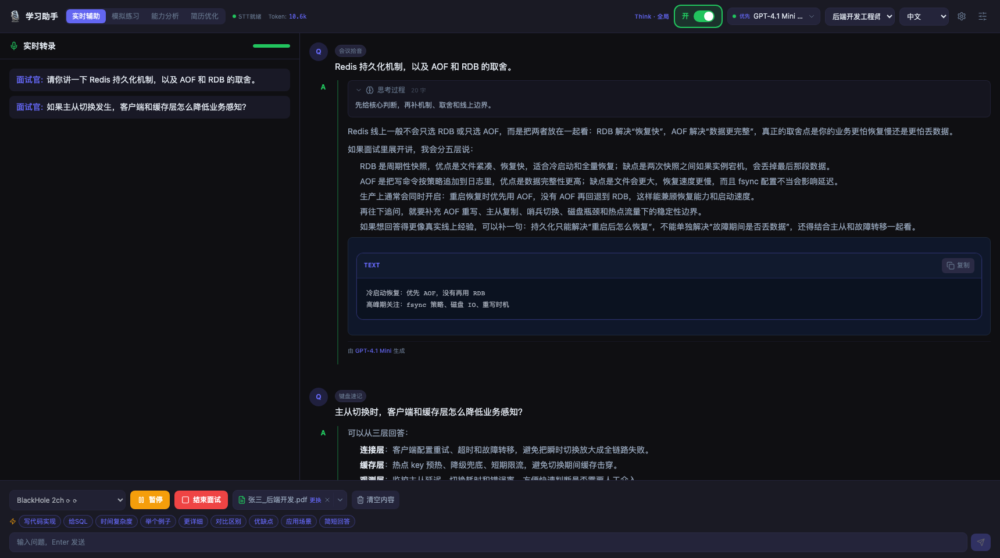
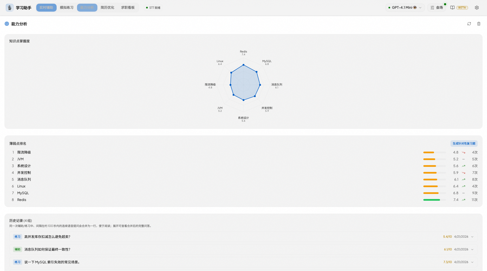
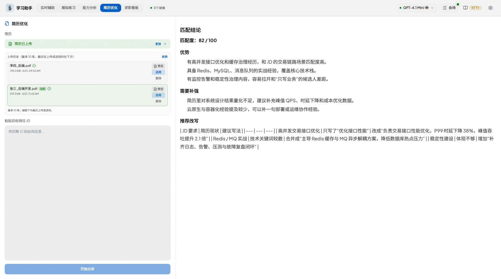
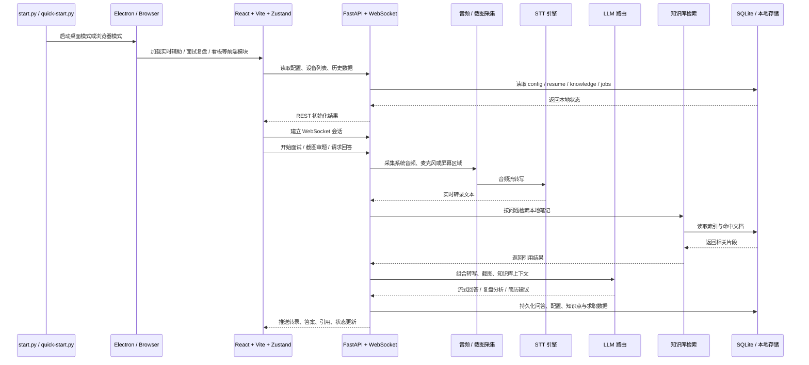

# 智能面试学习辅助助手

本仓库由 [walnut233](https://github.com/walnut233) 从 [powAu3/interview-assistant](https://github.com/powAu3/interview-assistant) 派生。原项目及其代码采用 [CC BY-NC 4.0](https://creativecommons.org/licenses/by-nc/4.0/) 许可。

此分支调整了手机端实时辅助的布局和顶栏，将扫码访问移到「设置 → 连接手机」，重排了模型配置表单，并适配了 GLM-5.3-Flash 与 DeepSeek Flash 的 Think 探测。Windows 启动脚本使用项目的 `.venv`，原启动脚本保存在 `启动.old.bat`。

## 使用前必读：仅限个人学习

> **本软件仅用于个人学习、技术研究、模拟练习和复盘。维护者明确要求：不得传播、转载、转售或以软件推广违规用途；不得用于任何可能造成违法行为的场景。**
>
> **禁止用于真实考试作弊、学术不端、未经许可的面试代答或隐蔽辅助、身份冒用、欺诈，以及其他违反法律法规、平台规则或组织要求的活动。请勿将屏幕、音频或个人资料采集能力用于侵犯他人隐私、商业秘密及其他合法权益。**

上述“不得传播”为维护者的使用倡议，不构成对上游 CC BY-NC 4.0 已授予权利的撤销或追加限制；具体许可范围见文末「许可与免责声明」。请仅从本仓库获取程序，不传播个人配置、API Key、录音、截图或他人资料。

软件提供语音转写、模型问答、截图分析、知识库、模拟练习和复盘功能。使用涉及他人的音频、画面或材料前，应取得必要授权并遵守所在场景的规则。

## 下载与发行计划

维护者后续会将最新的 Windows 安装版上传至本仓库的 [Releases（发行版）](https://github.com/walnut233/interview-assistant/releases)。**具体可下载版本及更新内容以发行版页面为准；源码已更新不代表对应安装包已经发布。**

Windows 安装版内置 Python、Whisper 和 FunASR CPU 运行环境，无需另行安装 Python、uv 或 Node.js；语音模型首次使用时按需下载。源码运行和制作安装包的方法见下文。

<p align="center">
  
  
  
  
  
  
</p>

## 为什么值得试

面向个人学习与模拟练习：转写练习问题、生成参考答案、引用自己的笔记，并在练习结束后复盘。模型输出仅供参考，应自行核实。

| 场景 | 能力 |
| --- | --- |
| **模拟练习** | 系统音频 / 麦克风转写，自动识别问题，多模型并行生成回答 |
| **语音与模型灵活接入** | 本地 FunASR / Whisper / 豆包 / 通用 ASR 四种转写引擎；OpenAI Chat、Anthropic Messages、OpenAI Responses 三种 LLM 接口协议，Base URL 带不带 `/v1` 都能用 |
| **题目学习** | 截图审题、识图模型分析、知识库引用本地笔记 |
| **个人材料接入** | 简历上传、简历优化、知识库引用本地笔记，让答案更贴近你的经历 |
| **桌面端使用体验** | 最大化／还原、最小化、托盘、轻量悬浮问答框、移动到鼠标附近 |
| **复盘与提升** | 面试复盘、知识点能力分析、求职看板、Offer 对比 |

## 模拟练习流程

1. 选择系统音频或麦克风，点击开始。
2. 左侧实时转写持续落字，系统自动识别“值得回答”的问题。
3. 右侧答案区按当前模型配置流式生成正式回答。
4. 需要审图时，可粘贴截图，把题目、代码片段或页面内容交给模型分析。
5. 开启知识库后，答案上方会显示引用角标，关联你的本地笔记或资料。
6. 空间紧张时，可用 `⌘⇧J / Ctrl+Shift+J` 折叠左侧实时转录面板，让回答区铺满。
7. 桌面端支持最小化、最大化／还原、托盘和悬浮提示窗。窗口控制或内容保护功能不代表可以在禁止辅助工具的场景使用本软件。

## 主界面速览

<p align="center">
  
</p>

## 关键能力雷达

<table>
  <tr>
    <td width="50%" valign="top">
      <h3>实时辅助</h3>
      <p>ASR 转写（FunASR / Whisper / 豆包，本地引擎支持岗位热词）、自动识别问题、流式回答、截图审题、知识库引用、多协议模型接入、模型健康与 Token 统计。</p>
    </td>
    <td width="50%" valign="top">
      <h3>桌面协同</h3>
      <p>Electron 端提供最大化／还原、最小化、托盘、悬浮问答框和快捷键，方便调整个人学习工作区。</p>
    </td>
  </tr>
  <tr>
    <td width="50%" valign="top">
      <h3>训练与复盘</h3>
      <p>面试复盘、问答记录、能力分析和薄弱点沉淀，方便把“答过的问题”变成“会讲的话题”。</p>
    </td>
    <td width="50%" valign="top">
      <h3>求职材料</h3>
      <p>简历上传与摘要、JD 对照优化、求职看板、Offer 对比，把面试前后动作收在一个工具里。</p>
    </td>
  </tr>
</table>

## 模块画廊

<table>
  <tr>
    <td width="50%"></td>
    <td width="50%"></td>
  </tr>
  <tr>
    <td align="center"><strong>能力分析</strong><br /><sub>知识点趋势、问答沉淀、薄弱项复盘</sub></td>
    <td align="center"><strong>简历优化</strong><br /><sub>把简历和 JD 放到一起，输出更像“能投出去”的版本</sub></td>
  </tr>
</table>

## 功能总览

| 模块 | 现在能做什么 |
| --- | --- |
| **实时辅助** | ASR 转写 → 问题识别 → 多模型回答 → 截图审题 / 知识库引用 |
| **知识库** | 上传 `.md` / `.txt` / `.log` / `.docx` / `.pdf`，支持检索测试、最近命中和回答引用 |
| **面试复盘** | 记录经授权的模拟练习问答、ASR 纠错、逐题分析、整场总结 |
| **能力分析** | 知识点标签、历史问答记录、薄弱点趋势 |
| **简历优化** | 上传简历，对照 JD 给出优化建议和改写方向 |
| **求职看板** | 表格 / Kanban、状态标签、拖拽排序、Offer 对比 |
| **设置中心** | 模型管理、STT 引擎、主题、偏好、快捷键、截图区域等配置 |

## 技术结构



### 技术栈

| 层 | 技术 |
| --- | --- |
| **前端** | React 18 · TypeScript · Vite · Zustand · Tailwind CSS · Playwright |
| **后端** | Python 3.10+ · FastAPI · Uvicorn · WebSocket |
| **语音识别** | FunASR · faster-whisper · 豆包 (Volcengine) · 通用 ASR (OpenAI-compatible) |
| **LLM** | OpenAI 兼容接口 · 多模型并行 · Think 推理 · 识图 |
| **存储** | SQLite · 本地简历历史 · 知识库索引 |
| **桌面** | Electron |

## 快速开始

### 1. 准备环境

- Python `3.10+`
- Node.js `18+`

### 2. 安装依赖

```bash
git clone https://github.com/walnut233/interview-assistant.git
cd interview-assistant

pip install -r backend/requirements.txt

cd frontend
npm install
npm run build
cd ..

cp backend/config.example.json backend/config.json
```

Windows 使用 uv 时，可在仓库根目录用下面的 PowerShell 命令创建环境、安装依赖并构建前端：

```powershell
uv venv --python 3.11
uv pip install -r backend/requirements.txt
npm.cmd --prefix frontend ci
npm.cmd --prefix frontend run build
Copy-Item backend/config.example.json backend/config.json
```

如果需要采集 Windows 系统音频，在同一虚拟环境中执行 `uv pip install soundcard`。

### 3. 配置模型与语音

模型支持三种接口协议（设置 → 模型 → 接口类型）：

- **OpenAI-Chat** 对应 OpenAI 兼容 `/chat/completions`
- **Anthropic-Messages** 对应 Anthropic `/v1/messages`
- **OpenAI-Responses** 对应 OpenAI `/responses`

请求地址带不带 `/v1` 都能自动适配。模型队列支持按优先级调度、健康检查和故障降级。「并行生成路数」限制实时辅助同时处理的答题任务数。

语音识别四种引擎（设置 → 语音）：

- **FunASR**（本地，中文面试推荐）：`pip install funasr` 后在设置页点「下载模型」；支持岗位热词偏置，纠正 RAG 等术语识别
- **Whisper**（本地，多语种）
- **豆包 / 通用 ASR**（云端）：可配置失败降级引擎（FunASR / Whisper / 不降级）

相关设置都在应用的「设置中心」里（语音、节奏、热词、模型分区），改 `backend/config.json` 也可以。

参考文档：

- [配置说明](docs/配置说明.md)
- [API 密钥与模型](docs/API密钥与模型.md)
- [音频配置](docs/音频配置.md)
- [豆包语音识别](docs/豆包语音识别.md)

### 4. 启动应用

```bash
python start.py                 # 桌面模式（推荐）
python start.py --mode network  # 浏览器模式，默认 http://localhost:18080
```

补充说明：

- Windows 完成安装后，双击 `启动.bat` 即可使用项目 `.venv` 启动桌面应用。
- `python start.py` 桌面模式（推荐）；`--mode network` 浏览器模式，默认 `http://localhost:18080`。
- 首次启动如果前端尚未构建，会自动安装并构建前端，因此本机仍需要 Node.js。
- 手机和电脑连接同一 Wi-Fi 后，在电脑端打开「设置 → 连接手机」，扫描二维码或输入页面给出的局域网地址。

## Windows 安装版

下载安装包 `InterviewAssistant-版本-Setup-x64.exe` 并按向导安装。程序内置 Python 3.11、Whisper 和 FunASR CPU 运行时，首次使用语音识别时下载模型。

**后续只维护 Windows 安装版，不再制作或更新免安装版。**

保存为 FunASR 引擎后，应用每次启动会在后台自动加载所选模型，并复用已经下载的本地模型缓存；模型文件保存在磁盘中，加载到内存的状态不会跨进程保留。

配置、面试历史、知识库和日志保存在 `%APPDATA%\InterviewAssistant`。首次打开需要重新配置模型。卸载时保留用户数据。

在 Windows x64 上制作安装程序，需要先安装前后端和桌面依赖，并在项目 `.venv` 中安装 `soundcard funasr torch torchaudio`，然后运行：

```powershell
npm.cmd --prefix desktop ci
npm.cmd --prefix desktop run package:win
```

成品输出到仓库根目录 `release`。构建只从 Git 跟踪的后端文件中复制程序，使用示例配置生成空模型列表，运行环境的依赖版本记录在成品的 `resources/runtime-requirements.txt` 中。

打包时会排除 PyTorch 的 C++ 开发链接库、头文件和编译工具，以及 NumPy、SciPy、scikit-learn 的测试目录。Electron 内置中英文语言资源，Whisper 和 FunASR 的 CPU 运行时随程序分发。

## 开发与自测

```bash
cd frontend && npm run dev
cd backend && python -m uvicorn main:app --host 127.0.0.1 --port 18080 --reload

cd frontend && npm test
python -m pytest backend/tests -q
```

开发模式提示：本地直接跑后端时默认不启用鉴权，`npm run dev` 的 Vite 代理可以直接访问
`http://localhost:18080`。只有 `python start.py --mode network`、`IA_AUTH_ENABLE=1`
或设置了 `IA_AUTH_TOKEN` 时，才会要求局域网请求携带 token。

## 项目结构

```text
interview-assistant/
├── README.md                       # 使用说明、发行计划与免责声明
├── LICENSE                         # 上游 CC BY-NC 4.0 许可
├── 启动.bat                        # Windows 本地 .venv 启动入口
├── 启动.old.bat                    # 保留的原启动脚本
├── start.py                        # 源码桌面／网络模式入口
├── quick-start.py                  # 快速启动入口
├── quick_start.py                  # 快速启动实现
├── backend/
│   ├── main.py                     # FastAPI 与 WebSocket 服务入口
│   ├── config.example.json         # 示例配置，不含个人密钥
│   ├── api/                        # 配置、语音、模型及业务接口
│   ├── core/                       # 配置、日志和基础组件
│   ├── services/                   # 语音、模型、知识库与存储服务
│   ├── assets/                     # 后端静态资源
│   └── tests/                      # 后端测试
├── frontend/
│   ├── src/
│   │   ├── components/             # 页面、设置中心及窗口控制
│   │   ├── hooks/                  # 状态同步与交互逻辑
│   │   ├── stores/                 # 前端状态与偏好
│   │   ├── lib/                    # API、协议与工具
│   │   └── types/                  # Electron 等类型定义
│   ├── scripts/                    # 开发辅助脚本
│   └── package.json                # 前端构建与测试命令
├── desktop/
│   ├── main.js                     # Electron 窗口、IPC、后端生命周期
│   ├── preload.js                  # 安全的桌面能力桥接
│   ├── backend-entry.py            # 打包版后端入口
│   ├── electron-builder.yml        # Windows 安装版配置
│   └── package.json                # 桌面启动、测试与打包命令
├── scripts/
│   └── build-windows.cjs           # 构建前端、整理运行时并制作 Windows 包
├── docs/                           # 配置文档、说明与截图
├── release/                        # 本地构建产物（不纳入 Git）
└── .packaging/                     # 打包暂存与工具缓存（不纳入 Git）
```

源码运行时的本地配置、缓存和日志不应提交到仓库。打包版用户数据独立存放在 `%APPDATA%\InterviewAssistant`，不在安装目录中。

## 常见问题

- **Node / npm 报错**：请确认 Node.js 版本为 `18+`。
- **Electron 下载慢**：可先设置 `ELECTRON_MIRROR=https://npmmirror.com/mirrors/electron/`，再进入 `desktop/` 执行 `npm install`。
- **macOS 下 sounddevice 安装失败**：先执行 `brew install portaudio`。
- **Whisper 模型下载慢**：可设置 `export HF_ENDPOINT=https://hf-mirror.com`。
- **中文/术语识别不准（如 RAG 被听错）**：主链路切到 FunASR 并下载模型，配合设置 → 热词里的岗位自定义词；Whisper 用户也可在热词页配置提示偏置。
- **转写时风扇狂转**：设置 → 节奏 → 性能，调低「本地 ASR 推理线程数」（默认自动 = min(8, 核数-2)）。
- **端口冲突**：可改用 `python start.py --port 9090`。

## 许可与免责声明

### 使用边界

**本项目只用于个人学习、技术研究、模拟练习与复盘，不用于真实考核中的未经许可辅助。维护者要求不得传播本软件，不得宣传、教授或利用其实施违规行为，不得在可能造成违法行为的场景使用。** 如使用场景禁止录音、截图、自动生成回答或辅助工具，应停止使用相关功能。

- 不得用于考试作弊、学术不端、未经许可的面试代答、身份冒用、欺诈或其他违法违规活动。
- 不得未经授权采集、上传、传播他人的声音、画面、简历、聊天记录、保密资料或个人信息。
- 不得转售软件、提供付费代答服务，或利用本项目从事违反原许可的商业活动。
- 不传播含有 API Key、访问令牌、个人资料或会话记录的配置、安装目录和数据文件。

### 原项目许可与传播说明

本仓库由 [powAu3/interview-assistant](https://github.com/powAu3/interview-assistant) 派生，保留 [CC BY-NC 4.0 许可](https://creativecommons.org/licenses/by-nc/4.0/) 和原作者署名。分支修改包括手机布局、设置页面、模型适配、Windows 打包和窗口控制等。

CC BY-NC 4.0 允许在遵守署名、非商业等条件时分享和改编，并禁止追加限制许可已允许行为的法律条款或技术措施。因此，本文“仅供学习”“不得传播”等维护者使用要求不应被理解为撤销原许可已授予的权利，也不替代或修改 `LICENSE`。第三方依赖、模型和服务适用各自的许可及使用条款。

### 风险与责任

软件、源码与打包程序按现状提供，不承诺识别或回答的准确性、服务可用性、数据完整性、特定场景适用性或任何规避检测效果。模型可能生成错误、遗漏或不当内容；请自行核实，不将输出直接作为重要决策依据。

使用云端模型或语音服务时，提交的文本、截图、音频和上下文可能发送给所配置的第三方服务。请先了解其数据政策、费用和使用规则，只提交有权处理的数据，并妥善保管密钥和备份。

使用者应自行确认用途符合适用法律、所在平台及组织规则，并对自己的使用行为负责。在适用法律允许的范围内，作者及维护者不对使用或无法使用本软件造成的损失承担责任；本声明不排除依法不得排除或限制的责任，也不为违法违规行为提供授权或免责。
